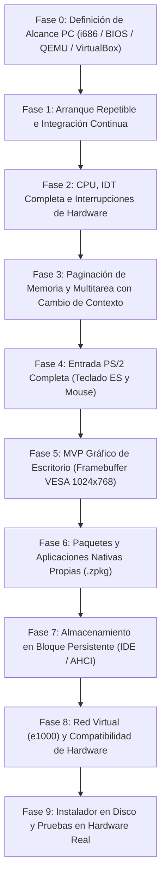

# Zenthra OS — Hoja de Ruta de Desarrollo (Roadmap)

> **Plan Maestro de Evolución hacia un Sistema Operativo de PC**  
> Formulado para el proyecto académico de grado de Camila Ianni (2026).

---

## Fases de Desarrollo

---

### Fase 0 — Alcance de PC y Arquitectura Objetivo
- **Plataforma Inicial**: x86 32-bit (i686 Protected Mode) para máxima estabilidad y claridad conceptual en el proyecto de grado.
- **Arranque**: BIOS tradicional con GRUB bajo especificación Multiboot 1 / 2.
- **Entornos Oficiales de Prueba**: QEMU para CI automatizado y Oracle VM VirtualBox para demostraciones interactivas.

### Fase 1 — Arranque Repetible e Integración Continua (COMPLETADA EN CI)
- [x] Flujo de compilación determinista y reproducible con `make clean` y `make test` en host local (221 tests).
- [x] Validación estricta de cabecera con `grub-file --is-x86-multiboot` en pipeline CI (Ubuntu runner).
- [x] Generación de ISO con `grub-mkrescue` y hash SHA-256 verificado en CI.
- [x] Arranque automatizado headless en QEMU (`make verify-qemu`) verificado en GitHub Actions CI (Run ID 39983159055).
- [ ] Reproducción local de ISO/QEMU en hosts macOS/Windows (requiere emulación o contenedor Linux).

### Fase 2 — CPU, IDT Completa e Interrupciones (COMPLETADA)
- [x] Tabla IDT de 256 descriptores.
- [x] Stubs en ensamblador (`interrupts.s`) para las 32 excepciones de CPU y 16 IRQs PIC 8259 remapeadas (32..47).
- [x] Volcado de registros y diagnóstico en serie (COM1) ante fallos no controlados.
- [x] Timer PIT a 100 Hz con heartbeat serie e instrucción `hlt`.

### Fase 3 — Multitarea Preemptiva y Planificación Real (COMPLETADA)
- [x] Cambio real de contexto de tarea en ensamblador (`switch_context`) y pilas dedicadas.
- [x] Segmento de Estado de Tarea (TSS) de 32 bits en hardware (DPL 0, selector 0x28, `esp0 = kernel_stack_top`).
- [x] Planificador Round-Robin preemptivo por quantum temporal (`task_schedule_tick`).
- [x] Soporte de suspensión y despertar automático de tareas (`task_sleep`).
- [x] Demostración de tarea CPU-bound sin yield preemptada forzosamente por PIT IRQ0.

### Fase 4 — Memoria Física y Paging x86 (COMPLETADA)
- [x] Parseo del mapa de memoria Multiboot 1 (`mmap_addr`) y reserva de áreas críticas (1 MiB bajo, kernel ELF, heap).
- [x] Asignador de marcos de página física (PMM) basado en bitmap de 4 KiB con reciclaje First-Fit y protección de desbordamiento en 64 bits.
- [x] Paginación de hardware x86 de 32 bits (`CR0.PG`, `CR0.WP`, carga de CR3).
- [x] Mapeo de identidad de 64 MiB para supervisor Ring 0 (kernel, VGA B8000, heap 4-6 MB).
- [x] Aislamiento de espacios virtuales y directorios de página por proceso (`vmm_create_process_directory`).
- [x] Manejador de Page Faults (#PF Vector 14 en IDT) con decodificación de código de error y lectura de CR2.

### Fase 5 — Primer Escritorio Gráfico (MVP en Código / Pruebas Host — Validación Visual VM Pendiente)
- [x] Petición de modo gráfico a Multiboot (1024x768 a 32 bpp, LFB).
- [x] Búfer de composición en RAM (Double Buffering) y función `gfx_flip()`.
- [x] Primitivas gráficas 2D: píxeles, rectángulos, líneas (Bresenham) y renderizado de texto con fuente de mapa de bits 8x16.
- [x] Puntero de ratón gráfico y gestor de eventos de cursor/botones.
- [x] Zenthra Window Manager: barra de tareas inferior, botón de menú, reloj y ventanas movibles.
- [x] Aplicación de Terminal Gráfica integrada sobre el escritorio.
- [ ] Validación visual interactiva y capturas de pantalla en emulador QEMU con GUI y VirtualBox.

### Fase 6 — Aplicaciones Propias, Proceso Ring 3 y Formato de Paquetes
- [ ] Definición formal de la ABI de llamadas al sistema (Syscalls) para Ring 3 (convenciones, estructuras y códigos de error).
- [ ] Cargador de ejecutables ELF i386 para Ring 3 (`load_elf` / `task_spawn_user`).
- [ ] Proceso userland mínimo de prueba con aislamiento estricto de memoria probado en QEMU.
- [ ] Formato de paquete binario nativo Zenthra (`.zpkg`) con manifiesto de metadatos, binario ELF compilado y firma digital criptográfica (SHA-256 / Ed25519).
- [ ] Suite de aplicaciones nativas esenciales de Zenthra: Terminal Gráfica, Monitor del Sistema, Explorador de Archivos y Editor de Texto.

### Fase 7 — Almacenamiento Persistente en Bloque
- [ ] Driver de controlador de disco IDE / ATA PIO de 32 bits.
- [ ] Particionamiento MBR y lectura/escritura de sectores de 512 bytes.
- [ ] Sistema de archivos persistente (ext2 o FAT32 simple) para que los archivos y registros sobrevivan al reinicio de la máquina.

### Fase 8 — Red y Conectividad
- [ ] Driver de tarjeta de red virtual Intel 82540EM (e1000) o virtio-net.
- [ ] Pila de protocolos de red mínima: Ethernet, ARP, IPv4, ICMP (ping) y UDP.

### Fase 9 — Instalador en Disco y Pruebas en Hardware
- [ ] Asistente de instalación de Zenthra OS desde la ISO hacia un disco duro virtual secundario.
- [ ] Pruebas de compatibilidad en computadoras físicas de repuesto (BIOS legacy).
