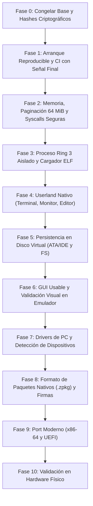

# Zenthra OS — Hoja de Ruta de Desarrollo (Roadmap v14)

> **Plan Maestro de Evolución hacia un Sistema Operativo de PC**  
> Formulado para el proyecto académico de grado de Camila Ianni (2026), estructurado con base en la **Auditoría Técnica v14**.

---

## 1. Diagrama de Evolución por Fases

---

## 2. Detalle de Fases y Criterios de Salida Verificables

### Fase 0 — Congelar Base y Registrar Hashes (COMPLETADA)
- [x] Versionar el commit y registrar hashes criptográficos SHA-256 en `build/BUILD_INFO.txt`.
- [x] Suite de pruebas automatizadas con 237 pruebas unitarias aprobadas (0 fallos).
- [x] Criterio de salida: Manifiesto reproducible con SHA-256 de binarios ELF e ISO.

### Fase 1 — Arranque Reproducible e Integración Continua (COMPLETADA EN CI)
- [x] Flujo de compilación determinista y reproducible con `make clean`, `make check-env` y `make test` (237 tests).
- [x] Validación estricta de cabecera con `grub-file --is-x86-multiboot` en CI (Ubuntu runner).
- [x] Generación de ISO con `grub-mkrescue` y hash SHA-256 verificado en CI.
- [x] Señal inequívoca de fin de prueba `ZENTHRA_QEMU_TEST_COMPLETE` emitida tras la finalización de todos los workers concurrentes y preempción PIT IRQ0.
- [x] Pipeline de GitHub Actions CI archivando ISO, ELF, `serial.log` y `BUILD_INFO.txt`.
- [ ] Reproducción local en hosts macOS/Windows (reportado de forma limpia como `[BLOCKED]` por herramientas de virtualización de host).

### Fase 2 — Memoria Física/Virtual y Syscalls Seguras (COMPLETADA)
- [x] Aritmética de 64 bits en PMM a prueba de desbordamiento en redondeos superiores (`UINT64_MAX`) y reserva de regiones críticas.
- [x] Unificación del Identity Mapping del kernel supervisor a 64 MiB (`KERNEL_IDENTITY_TABLES = 16`, `KERNEL_IDENTITY_MAP_SIZE = 64 MiB`).
- [x] Verificación de accesibilidad de directorio con `vmm_is_directory_accessible(pd)` impidiendo desreferencias físicas no mapeadas.
- [x] Inspección segura página por página en `strnlen_user()` exigiendo `PTE_PRESENT` y `PTE_USER` antes de desreferenciar cada byte, evitando `#PF` en Ring 0.
- [x] Definición formal de la ABI de `SYS_WRITE` para buffers binarios (`count == 0` retorna 0 según POSIX, sin requerir terminador NUL) y `SYS_READ`.

### Fase 3 — Proceso Ring 3 y Cargador ELF i386 (PRÓXIMO OBJETIVO)
- [ ] Definición formal de la ABI de llamadas al sistema (Syscalls) para Ring 3 (convenciones, estructuras y códigos de error).
- [ ] Cargador de ejecutables ELF i386 de 32 bits (`load_elf` / `task_spawn_user`).
- [ ] Pila de kernel por proceso (`kernel_stack`) vinculada al TSS x86 para transiciones Ring 3 -> Ring 0.
- [ ] Espacio de direcciones virtual aislado con páginas `PTE_USER` y denegación de acceso a espacio kernel (`USER_MEMORY_LIMIT`).
- [ ] Criterio de salida: Una aplicación mínima de usuario en Ring 3 ejecutada en QEMU que invoca `SYS_WRITE` y no puede acceder a memoria del kernel ni de otras tareas.

### Fase 4 — Userland Nativo
- [ ] Suite de utilidades esenciales ejecutadas como procesos independientes fuera del kernel.
- [ ] Terminal de comandos gráfica interactiva como binario de usuario.
- [ ] Monitor del sistema en vivo con telemetría de memoria y tareas vía syscalls.
- [ ] Editor de texto sencillo y visor de archivos.
- [ ] Criterio de salida: Aplicaciones nativas del proyecto ejecutadas fuera del kernel, con fallos y salidas aisladas del núcleo.

### Fase 5 — Persistencia en Disco Virtual
- [ ] Controlador de disco IDE / ATA PIO de 32 bits (canales primario y secundario).
- [ ] Detección e inicialización de unidades de disco duro en QEMU.
- [ ] Lectura y escritura de sectores LBA de 512 bytes con validación de integridad.
- [ ] Sistema de archivos persistente mínimo (FAT32 o ext2 básico).
- [ ] Criterio de salida: Crear un archivo en sesión, reiniciar QEMU y recuperar el contenido de forma idéntica e íntegra.

### Fase 6 — Interfaz Gráfica Usable (GUI)
- [ ] Primitivas de renderizado aceleradas por software en VESA LFB 1024x768x32bpp con doble búfer.
- [ ] Gestor de ventanas con recorte 2D riguroso, barra de tareas, menú launcher y foco dinámico.
- [ ] Controlador PS/2 de ratón con aceleración y decodificación de paquetes con verificación de ACK.
- [ ] Política de redibujado bajo demanda (`needs_redraw`) para consumo ultra-bajo de CPU.
- [ ] Criterio de salida: Prueba de humo visual repetible en QEMU con interfaz gráfica y capturas de pantalla de la GUI.

### Fase 7 — Drivers de PC y Detección de Dispositivos
- [ ] Enumeración de bus PCI (detección de periféricos, IDs de proveedor/dispositivo y recursos BAR).
- [ ] Detección avanzada de topología de procesador y control de energía ACPI.
- [ ] Controladores de teclado y ratón USB mediante emulación UHCI/EHCI.
- [ ] Matriz de compatibilidad documentada con resultados verificados por dispositivo.

### Fase 8 — Formato de Paquetes Nativos (.zpkg) y Firmas
- [ ] Formato de paquete nativo `.zpkg` con manifiesto versionado, binario ELF y firma criptográfica.
- [ ] Mecanismo de verificación con claves públicas de confianza (Ed25519 o SHA-256 HMAC).
- [ ] Instalación y desinstalación transaccional con rollback ante fallos de almacenamiento o corrupción.

### Fase 9 — Port Moderno (x86-64 y UEFI)
- [ ] Rama de desarrollo separada para arquitectura x86-64 (Long Mode) con paginación de 4 niveles (PML4).
- [ ] Soporte de arranque UEFI mediante cabecera PE/COFF y protocolo GNU-EFI.
- [ ] Adaptación de syscalls (`syscall`/`sysret`) y userland a 64 bits.

### Fase 10 — Validación en Hardware Físico
- [ ] Pruebas en PCs y netbooks seleccionadas con BIOS Legacy y arranque por USB.
- [ ] Matriz de resultados físicos: modelo de equipo, firmware, memoria RAM detectada, vídeo, teclado y resultado de arranque.
