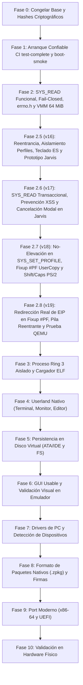

# Zenthra OS — Hoja de Ruta de Desarrollo (Roadmap v19)

> **Plan Maestro de Evolución hacia un Sistema Operativo de PC**  
> Formulado para el proyecto académico de grado de Camila Ianni (2026), estructurado con base en la **Auditoría Técnica v19**.

---

## 1. Diagrama de Evolución por Fases

---

## 2. Detalle de Fases y Criterios de Salida Verificables

### Fase 0 — Congelar Base y Registrar Hashes (COMPLETADA)
- [x] Versionar el commit y registrar hashes criptográficos SHA-256 en `build/BUILD_INFO.txt`.
- [x] Suite de pruebas automatizadas con 251 pruebas unitarias aprobadas (0 fallos).
- [x] Criterio de salida: Manifiesto reproducible con SHA-256 de binarios ELF e ISO.

### Fase 1 — Arranque Confiable e Integración Continua (COMPLETADA EN CI)
- [x] Flujo de compilación determinista y reproducible con `make clean`, `make check-env` y `make test` (478 tests).
- [x] Validación estricta de cabecera con `grub-file --is-x86-multiboot` en CI (Ubuntu runner).
- [x] Generación de ISO con `grub-mkrescue` y hash SHA-256 verificado en CI.
- [x] Separación estricta de pruebas en QEMU:
  - `verify-qemu-complete`: Ejecución directa del kernel con bandera `test-mode`, verificación de `#PF` real con redirección de `EIP` (`[VMM_FIXUP_QEMU_PASS]`), emisión del marcador `ZENTHRA_QEMU_TEST_COMPLETE`, apagado limpio ACPI y finalización con **exit code 0**. **No se acepta timeout 124 como PASS**.
  - `verify-qemu-smoke`: Arranque de la imagen ISO con GRUB, inicialización gráfica VESA LFB, ratón PS/2, gestor de ventanas y estabilidad del escritorio sin pánicos de CPU.
- [x] Pipeline de GitHub Actions CI archivando ISO, ELF, `serial.log` y `BUILD_INFO.txt`.
- [ ] Reproducción local en hosts macOS/Windows (reportado de forma limpia como `[BLOCKED]` por herramientas de virtualización de host).

### Fase 2 — Entrada Real, Syscalls Seguras, Memoria Fail-Closed y errno.h (COMPLETADA)
- [x] Implementación funcional de `SYS_READ` conectada a cola circular de teclado y terminal.
- [x] Validación de memoria Fail-Closed en `is_user_pages_accessible_failclosed()`.
- [x] Centralización de códigos de error y ABI de syscalls en `kernel/include/errno.h`.
- [x] Aritmética de 64 bits en PMM a prueba de desbordamiento en redondeos superiores (`UINT64_MAX`).
- [x] Unificación del Identity Mapping del kernel supervisor a 64 MiB.
- [x] Inspección segura bloque por bloque en `strnlen_user()` exigiendo `PTE_PRESENT` y `PTE_USER`.
- [x] Definición formal de la ABI de `SYS_WRITE` para buffers binarios.

### Fase 2.5 — Auditoría Técnica v16: Reentrancia, Aislamiento de Perfiles, Teclado ES y Prototipo Jarvis (COMPLETADA)
- [x] **Aislamiento Estricto de Perfiles**: `SYS_SET_PROFILE` modifica exclusivamente `cur->profile` y no altera el perfil global de ACL (`acl_get_active_profile()`).
- [x] **Reentrancia de Syscalls**: Eliminación del buffer estático global `kernel_safe_buf[256]`; asignación en la pila de kernel privada de cada tarea (`kbuf_write`, `kbuf_read`) para garantizar seguridad frente a preempción.
- [x] **ABI de `SYS_READ` Completa**: Validación de flags en EDX (`SYS_READ_NONBLOCK`, `SYS_READ_BLOCKING` documentado con `-ENOSYS`, flags inválidos con `-EINVAL`), buffers acotados a `to_read` bytes con validación de punteros fail-closed.
- [x] **Driver de Teclado PS/2 Ampliado**: Modificadores Shift make/break, Caps Lock con inversión XOR de glifos, tablas US y Español Básico ASCII (`KEYBOARD_LAYOUT_ES`), y telemetría de eventos de saturación (`keyboard_get_overflow_count`).
- [x] **Prototipo Independiente de Escritorio & Jarvis Multi-Agente (`desktop_prototype/`)**: Glassmorphism auténtico, Dock flotante, Terminal gráfica, panel interactivo de Jarvis con planes por pasos, modal de confirmación crítica, centro de 6 agentes (Backend, Ciberseguridad, Kernel/OS, Datos, Creativo/UI, Automatización), arquitectura Gateway híbrida sin secretos hardcodeados y etiquetas `[DEMO]`.

### Fase 2.6 — Auditoría Técnica v17: Lectura Transaccional, Aislamiento Total de `task_set_current_profile` y Seguridad DOM en Jarvis (COMPLETADA)
- [x] **Separación Total en `task_set_current_profile()`**: Eliminada la llamada residual a `acl_set_active_profile(profile)` dentro de `kernel/drivers/task.c`, asegurando que el perfil global de ACL (`acl_get_active_profile()`) nunca sea contaminado por cambios de perfil en tareas individuales.
- [x] **Lectura Transaccional en `SYS_READ`**: Implementadas `keyboard_peek_queue()` y `keyboard_discard_chars()` en `kernel/drivers/keyboard.c`. `SYS_READ` inspecciona los bytes sin retirarlos de la cola, copia a userland con `copy_to_user()` y solo descarta los caracteres tras confirmar que la copia tuvo éxito (`-EFAULT` preserva el 100% de la cola intacta).
- [x] **Acotamiento y Eficiencia en `SYS_WRITE`**: Límite de transferencia por llamada (`MAX_SYSCALL_TRANSFER_SIZE = 65536` bytes) y validación única por chunk dentro de `copy_from_user()`.
- [x] **Seguridad DOM Anti-XSS y Cancelación Modal en `desktop_prototype/`**: Eliminadas todas las asignaciones con `innerHTML` en `app.js` (reemplazadas por creación segura de nodos con `textContent`), cancelación inmediata de `requestUserApproval` al abortar un plan con el modal abierto, banner persistente de simulación `[DEMO]`, sincronización completa de foco/minimizado en el dock y delimitación al contenedor en resize/drag.

### Fase 2.7 — Auditoría Técnica v18: Prevención de Escalamiento en `SYS_SET_PROFILE`, Fixup `#PF` en Copias de Usuario y Robustez de Teclado PS/2 (COMPLETADA)
- [x] **Cierre de Escalamiento de Privilegios en `SYS_SET_PROFILE`**: Implementada `acl_can_transition_profile(from_prof, to_prof)` en `kernel/drivers/acl_security.c`. Exige monotonicidad de capacidades (`(to_mask & ~from_mask) == 0`), bloqueando con `-EACCES` cualquier intento de perfiles con `OP_SYSTEM_ADMIN` (Backend, Frontend, Fullstack, Ciberseguridad) de autoelevarse a `PROFILE_IOT_HARDWARE` para obtener `OP_ARDUINO_WRITE` / `OP_ARDUINO_READ`.
- [x] **Modo Fail-Closed sin Paginación**: En modo kernel (`syscall_set_require_paging(true)`), `is_user_pages_accessible_failclosed` falla cerrado si la paginación está desactivada.
- [x] **Atomicidad UP en `SYS_READ` y Validación Única por Chunk en `SYS_WRITE`**: `SYS_READ` protege toda la transacción `peek -> copy_to_user -> discard` con `scheduler_lock()`. `SYS_WRITE` elimina la comprobación global redundante y garantiza retorno exacto de escritura parcial.
- [x] **Shift Izquierdo/Derecho Independientes y Protección Anti-Autorepetición en Caps Lock**: Seguimiento separado de `left_shift_pressed` y `right_shift_pressed`, y detección de flanco en Caps Lock (`0x3A` Make / `0xBA` Break) para evitar alternancias múltiples por autorepetición del controlador 8042.

### Fase 2.8 — Auditoría Técnica v19: Redirección Real de `EIP` en Recuperación de Page Fault (`fixup`), Pila Reentrante de Contexto y Prueba de Hardware en QEMU (COMPLETADA)
- [x] **Recuperación Real de Page Fault (`fixup`) con Redirección de `EIP`**: Implementada `arch_user_copy_bytes` en `kernel/arch/x86/interrupts.s` exportando `__user_copy_fault_start`, `__user_copy_fault_end` y `__user_copy_fault_fixup`. Cuando ocurre un `#PF` en `rep movsb`, `page_fault_handler` modifica `regs->eip = ctx->fixup_eip` para que `iret` salte a `__user_copy_fault_fixup` y retorne `-1` (`-EFAULT`) sin reejecutar la instrucción fallida en un bucle infinito.
- [x] **Vinculación Estricta por Rango de `EIP` y Dirección `CR2`**: `page_fault_handler` verifica simultáneamente que `regs->eip` esté dentro de `[eip_start, eip_end)` y que `CR2` esté dentro de `[user_start, user_end)`. Cualquier `#PF` en Ring 0 fuera de la instrucción de copia o fuera del rango de usuario registrado conserva su diagnóstico normal y `KERNEL PANIC`.
- [x] **Pila Reentrante de Contextos de Copia (`copy_ctx_stack[4]`)**: Reemplazo de banderas globales planas por `page_fault_push_user_copy_ctx()` y `page_fault_pop_user_copy_ctx()`, soportando anidamiento sin pérdida de contexto exterior y rechazando desbordamientos de profundidad.
- [x] **Prueba Real de `#PF` de Hardware en QEMU (`verify_real_hardware_pf_fixup_in_qemu`)**: Verifica en ejecución real bare-metal en QEMU que tanto el cruce hacia una página no mapeada (`0x40001000`) como la escritura en una página de solo lectura (`0x40000000` sin `PTE_WRITABLE`, con `CR0.WP=1`) disparan `isr14`, redirigen `EIP` a `__user_copy_fault_fixup`, retornan `-1` (`-EFAULT`) y emiten `[VMM_FIXUP_QEMU_PASS]` exigido en `make verify-qemu-complete`.
- [x] **Validación Autoritativa Única en `SYS_READ`**: Eliminada la validación previa redundante de 1 byte cuando existen datos en la cola; `copy_to_user(user_buf, kbuf_read, peeked)` realiza la única validación del rango exacto de `peeked` bytes.
- [x] **Suite de Pruebas Unitarias**: Ampliada a **478 pruebas automatizadas aprobadas (0 fallos, 0 warnings)**.

### Fase 3 — Proceso Ring 3 y Cargador ELF i386 (PRÓXIMO OBJETIVO)
- [ ] Definición formal de la ABI de llamadas al sistema (Syscalls) para Ring 3 (convenciones, estructuras y códigos de error).
- [ ] Cargador de ejecutables ELF i386 de 32 bits (`load_elf` / `task_spawn_user`).
- [ ] Pila de kernel por proceso (`kernel_stack`) vinculada al TSS x86 para transiciones Ring 3 -> Ring 0.
- [ ] Espacio de direcciones virtual aislado con páginas `PTE_USER` y denegación de acceso a espacio kernel (`USER_MEMORY_LIMIT`).
- [ ] Criterio de salida: Una aplicación mínima de usuario en Ring 3 ejecutada en QEMU que invoca `SYS_WRITE` y no puede acceder a memoria del kernel ni de otras tareas.

### Fase 4 — Userland Nativo
- [ ] Suite de utilidades esenciales ejecutadas como procesos independientes fuera del kernel.
- [ ] Terminal de comandos gráfica interactiva como binario de usuario.
- [ ] Monitor del sistema en vivo con telemetría de memoria y tareas vía syscalls.
- [ ] Editor de texto sencillo y visor de archivos.
- [ ] Criterio de salida: Aplicaciones nativas del proyecto ejecutadas fuera del kernel, con fallos y salidas aisladas del núcleo.

### Fase 5 — Persistencia en Disco Virtual
- [ ] Controlador de disco IDE / ATA PIO de 32 bits (canales primario y secundario).
- [ ] Detección e inicialización de unidades de disco duro en QEMU.
- [ ] Lectura y escritura de sectores LBA de 512 bytes con validación de integridad.
- [ ] Sistema de archivos persistente mínimo (FAT32 o ext2 básico).
- [ ] Criterio de salida: Crear un archivo en sesión, reiniciar QEMU y recuperar el contenido de forma idéntica e íntegra.

### Fase 6 — Interfaz Gráfica Usable (GUI)
- [ ] Primitivas de renderizado aceleradas por software en VESA LFB 1024x768x32bpp con doble búfer.
- [ ] Gestor de ventanas con recorte 2D riguroso, barra de tareas, menú launcher y foco dinámico.
- [ ] Controlador PS/2 de ratón con aceleración y decodificación de paquetes con verificación de ACK.
- [ ] Política de redibujado bajo demanda (`needs_redraw`) para consumo ultra-bajo de CPU.
- [ ] Criterio de salida: Prueba de humo visual repetible en QEMU con interfaz gráfica y capturas de pantalla de la GUI.

### Fase 7 — Drivers de PC y Detección de Dispositivos
- [ ] Enumeración de bus PCI (detección de periféricos, IDs de proveedor/dispositivo y recursos BAR).
- [ ] Detección avanzada de topología de procesador y control de energía ACPI.
- [ ] Controladores de teclado y ratón USB mediante emulación UHCI/EHCI.
- [ ] Matriz de compatibilidad documentada con resultados verificados por dispositivo.

### Fase 8 — Formato de Paquetes Nativos (.zpkg) y Firmas
- [ ] Formato de paquete nativo `.zpkg` con manifiesto versionado, binario ELF y firma criptográfica.
- [ ] Mecanismo de verificación con claves públicas de confianza (Ed25519 o SHA-256 HMAC).
- [ ] Instalación y desinstalación transaccional con rollback ante fallos de almacenamiento o corrupción.

### Fase 9 — Port Moderno (x86-64 y UEFI)
- [ ] Rama de desarrollo separada para arquitectura x86-64 (Long Mode) con paginación de 4 niveles (PML4).
- [ ] Soporte de arranque UEFI mediante cabecera PE/COFF y protocolo GNU-EFI.
- [ ] Adaptación de syscalls (`syscall`/`sysret`) y userland a 64 bits.

### Fase 10 — Validación en Hardware Físico
- [ ] Pruebas en PCs y netbooks seleccionadas con BIOS Legacy y arranque por USB.
- [ ] Matriz de resultados físicos: modelo de equipo, firmware, memoria RAM detectada, vídeo, teclado y resultado de arranque.
