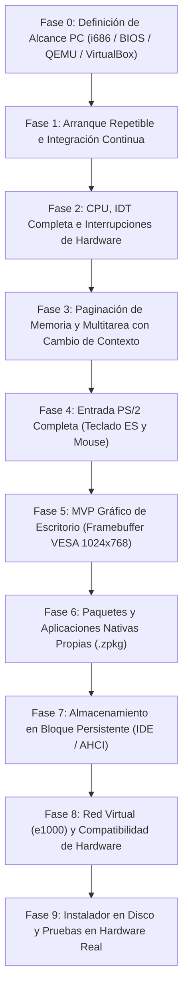

# Zenthra OS — Hoja de Ruta de Desarrollo (Roadmap)

> **Plan Maestro de Evolución hacia un Sistema Operativo de PC**  
> Formulado para el proyecto académico de grado de Camila Ianni (2026).

---

## Fases de Desarrollo

---

### Fase 0 — Alcance de PC y Arquitectura Objetivo
- **Plataforma Inicial**: x86 32-bit (i686 Protected Mode) para máxima estabilidad y claridad conceptual en el proyecto de grado.
- **Arranque**: BIOS tradicional con GRUB bajo especificación Multiboot 1 / 2.
- **Entornos Oficiales de Prueba**: QEMU para CI automatizado y Oracle VM VirtualBox para demostraciones interactivas.

### Fase 1 — Arranque Repetible e Integración Continua (COMPLETADA)
- [x] Flujo de compilación determinista y reproducible con `make clean`, `make test`, `make iso`.
- [x] Validación estricta de cabecera con `grub-file --is-x86-multiboot`.
- [x] Pipeline de GitHub Actions 100% en verde con generación de ISO y verificación automática.

### Fase 2 — CPU, IDT Completa e Interrupciones (COMPLETADA)
- [x] Tabla IDT de 256 descriptores.
- [x] Stubs en ensamblador (`interrupts.s`) para las 32 excepciones de CPU y 16 IRQs PIC 8259 remapeadas (32..47).
- [x] Volcado de registros y diagnóstico en serie (COM1) ante fallos no controlados.
- [x] Timer PIT a 100 Hz con heartbeat serie e instrucción `hlt`.

### Fase 3 — Paginación y Procesos Reales (EN CURSO)
- [x] Cambio real de contexto de tarea en ensamblador (`switch_context`).
- [x] Demostración de tareas concurrentes alternantes con contadores reales en log serial.
- [ ] Asignador de marcos de página física (PMM - Physical Memory Manager) basado en el mapa de memoria de Multiboot.
- [ ] Paginación de hardware (CR0.PG, Page Directory y Page Tables de 4 KiB) con protección de memoria Ring 0 / Ring 3.
- [ ] Segmento de Estado de Tarea (TSS) para recarga automática de `ESP0` al recibir interrupciones en Ring 3.

### Fase 4 — Entrada y Consola de Recuperación
- [ ] Driver de teclado PS/2 completo: decodificación de scancodes make/break, teclas modificadoras (Shift, Ctrl, Alt) y distribución de teclado en Español (ES / Latam).
- [ ] Driver de ratón PS/2 (IRQ 12): máquina de estados para paquetes de 3 bytes y coordenadas de puntero.
- [ ] Mantenimiento de la consola de texto VGA 80x25 como herramienta de diagnóstico y modo de rescate.

### Fase 5 — Primer Escritorio Gráfico (MVP Visible)
- [ ] Petición de modo gráfico a Multiboot (1024x768 a 32 bpp, LFB).
- [ ] Búfer de composición en RAM (Double Buffering) y función `gfx_flip()`.
- [ ] Primitivas gráficas 2D: píxeles, rectángulos, líneas (Bresenham) y renderizado de texto con fuente de mapa de bits 8x16.
- [ ] Puntero de ratón gráfico y gestor de eventos de cursor/botones.
- [ ] Zenthra Window Manager: barra de tareas inferior, botón de menú, reloj y ventanas movibles.
- [ ] Aplicación de Terminal Gráfica integrada sobre el escritorio.

### Fase 6 — Aplicaciones Propias y Formato de Paquetes
- [ ] Formato de paquete binario Zenthra (`.zpkg`) con manifiesto de metadatos, binario ELF compilado y firma digital criptográfica (SHA-256 / Ed25519).
- [ ] Reemplazo de los marcadores simulados de aplicaciones comerciales por herramientas nativas de Zenthra (Monitor de Sistema, Explorador de Archivos, Consola IoT, Editor de Texto).

### Fase 7 — Almacenamiento Persistente en Bloque
- [ ] Driver de controlador de disco IDE / ATA PIO de 32 bits.
- [ ] Particionamiento MBR y lectura/escritura de sectores de 512 bytes.
- [ ] Sistema de archivos persistente (ext2 o FAT32 simple) para que los archivos y registros sobrevivan al reinicio de la máquina.

### Fase 8 — Red y Conectividad
- [ ] Driver de tarjeta de red virtual Intel 82540EM (e1000) o virtio-net.
- [ ] Pila de protocolos de red mínima: Ethernet, ARP, IPv4, ICMP (ping) y UDP.

### Fase 9 — Instalador en Disco y Pruebas en Hardware
- [ ] Asistente de instalación de Zenthra OS desde la ISO hacia un disco duro virtual secundario.
- [ ] Pruebas de compatibilidad en computadoras físicas de repuesto (BIOS legacy).
